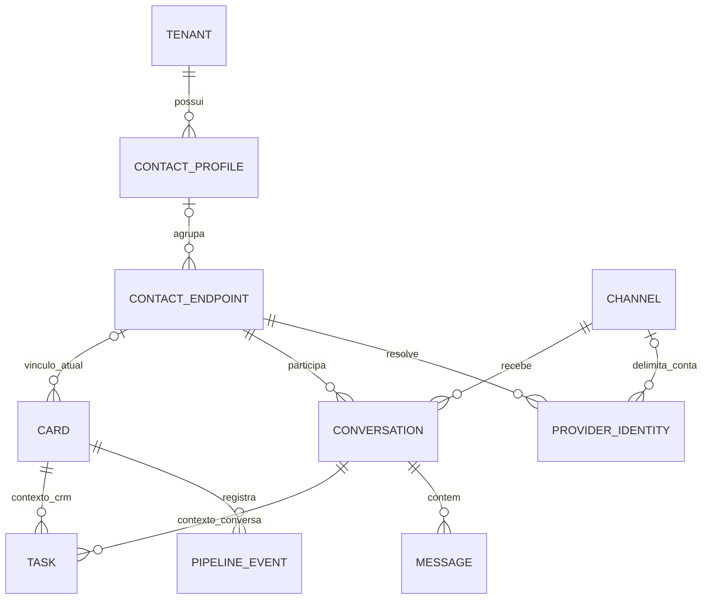

# Modelo de domínio: ficha da pessoa e meios de contato

Data: 26/10/2026. Responsável: @architect. Revisões de dados e produto concluídas por
@data-engineer e @po, com ajustes incorporados. Estado: proposta de modelagem; não há alteração
de schema ou migração executada. As revisões não constituem QA de uma implementação.

Base: [investigação inicial](project-analysis.md) e [abordagem de entrega](recommended-approach.md).
Este documento substitui a sugestão inicial de colocar o endereço diretamente no Contact legado.

## 1. Decisão do owner e significado das entidades

Em 26/10/2026, perguntado se a mesma pessoa deveria ter uma ficha reunindo telefone, e-mail e
Instagram, o owner respondeu: **“Sim, uma ficha com vários meios de contato”**.

O modelo precisa representar essa distinção:

| Conceito | Significado | Dono proposto |
|---|---|---|
| Ficha da pessoa | Cadastro que reúne identidade cadastral, endereço e meios relacionados | Módulo Contatos |
| Meio/contato operacional | Identificador usado pelas conversas; corresponde ao Contact ID atual | Contrato operacional preservado, com propriedade a extrair progressivamente |
| Identidade do provider | JID, LID ou ID social resolvido e escopado para comunicação | Identidade de comunicação |
| Canal | Conta/número da empresa pelo qual se comunica | Conversas/Canais |
| Negócio | Uma negociação, com funil, etapa, valor, resultado/motivo e retorno | CRM/Pipelines |
| Conversa | Atendimento de um meio de contato em um canal | Conversas |
| Mensagem | Conteúdo trocado dentro da conversa | Conversas |
| Tarefa | Pendência do domínio Tasks, relacionada a card ou conversa quando aplicável | Tarefas |

A ficha também serve para quem ainda não comprou; não depende do status cliente/comprador.
Organização/empresa, contato compartilhado por várias pessoas e múltiplos endereços não foram requisitos.

## 2. Comparação de alternativas

| Alternativa | Atende ficha com vários meios? | Compatibilidade | Avaliação |
|---|---|---|---|
| A. Ampliar Contact atual | Não, sem outra camada de vínculo | Boa para o modelo por identificador | Insuficiente como modelo final após a decisão do owner |
| B. Criar cadastro acima dos Contact IDs | Sim | Preserva IDs e contratos operacionais | Recomendada |
| C. Transformar Contact em pessoa e criar endpoints filhos | Sim | Reinterpreta IDs usados por muitos domínios | Maior ruptura; não recomendada nesta evolução |

**Recomendação técnica B:** entidade candidata `ContactProfile` para a ficha; coleção candidata
`contact_profiles`. O Contact existente permanece um identificador operacional. Não reutilizar
`customerId`/Customer legado como se já fosse cadastro mestre implementado.

O nome técnico pode ser refinado; a distinção de significado é obrigatória.
`Contact.profile` existente é foto, não a nova ficha. Usar `contactProfileId` para o vínculo,
evitando confundir foto e referência cadastral.

## 3. Modelo lógico e cardinalidades

`CONTACT_ENDPOINT` é o Contact legado, sem renomear IDs ou coleção nesta proposta.
A relação de tarefa no diagrama representa contexto lógico; o schema atual usa contextType/contextId.
Cada tarefa tem no máximo um desses contextos por esse par: card e conversa são alternativas,
não duas referências simultâneas obrigatórias. Também existem tarefas fora desses contextos.

- Uma ficha reúne vários Contact IDs no mesmo tenant.
- Um Contact pode estar sem ficha durante a migração, ou pertencer a uma ficha atual.
- A cardinalidade proposta não permite compartilhar o mesmo Contact entre duas pessoas.
- Uma ficha sem meio é uma possibilidade de cadastro manual, ainda não decisão de produto.
- Várias identidades de provider podem resolver o mesmo Contact, por exemplo JID e LID.
- Um card pode continuar sem Contact quando legado; não inventar vínculo por nome.
- Unificar fichas não unifica conversas nem execuções de automação.
- Não há relação nova de pessoa diretamente com cada mensagem; a agregação conserva os vínculos existentes.

## 4. Esquema lógico proposto

É especificação de dados para revisão, não DDL nem interface pronta para uso no app.

### 4.1 ContactProfile: cadastro canônico

| Campo | Semântica |
|---|---|
| id | ID novo da ficha, diferente do Contact ID |
| tenantId | Tenant obrigatório |
| displayName | Nome cadastral da pessoa, editável sob permissão |
| displayNameSource | Proveniência gerida no servidor: manual, legacy ou provider |
| avatarUrl | Foto cadastral opcional; não transformar o campo foto legado em FK |
| address | Endereço atual opcional, como value object |
| version | Versão para edição e vínculo concorrentes |
| createdAt / updatedAt | Datas do cadastro |

Address proposto: logradouro, número textual, complemento, bairro, cidade, estado/região,
código postal e país. Campos opcionais e formato de validação serão fechados na story.
Não preencher país/UF automaticamente sem contexto e não interpretar número de imóvel como inteiro.

Nome e endereço não são únicos. Não acrescentar CPF/CNPJ ou regras de cliente ativo por inferência.
Campos personalizados e observações permanecem extensões a refinar; não usar Mixed genérico
para substituir decisões de tipos e validação do cadastro.

### 4.2 Contact: preservar identidade e adicionar vínculo

Manter id, tenantId, type, value, name/profile legados, providers e datas.
Adicionar `contactProfileId?: ObjectId | null`, associado à ficha no mesmo tenant.
Adicionar `contactProfileLinkVersion` com incremento explícito em toda alteração desse vínculo.
A escrita filtra tenant, FK anterior e versão esperada e incrementa a versão no mesmo update.
Não presumir incremento de `__v` do Mongoose em findOneAndUpdate. O backfill deve distinguir
versão ausente no legado e a primeira versão materializada, sem resetar versão já existente.

O vínculo atual fica em **um lugar só**: Contact.contactProfileId.
Não manter em paralelo `ContactProfile.contactIds[]` como segunda fonte de verdade.
Listar os meios pela consulta tenantId + contactProfileId.

Uma coleção de vínculos só substituiria esse campo se fosse escolhida associação temporal ou
histórico de titularidade como requisito. Não duplicar as duas representações atuais.
Auditar operações de agrupamento não exige que a FK atual tenha duas fontes de verdade.

### 4.3 Identificadores que podem ser apresentados como meios

- Telefone/e-mail informado manualmente precisa passar pela normalização e resolução já existentes.
- Um valor existente não cria Contact duplicado; devolve o registro existente para a etapa de vínculo.
- Instagram resolvido depende da identidade real do provider e de seu escopo de conta.
  Digitar um @username não cria um IGSID válido nem autoriza envio proativo.
- Um LID sem telefone resolvido não deve ser exibido como telefone confirmado da pessoa.
- JID/LID não viram dois telefones no cadastro: são formas de resolver comunicação do Contact.
- Adicionar uma informação ao cadastro não implica disponibilidade em todos os canais/providers.
- Bloqueio/arquivamento de ContactChannel continuam ligados ao canal e ao contato operacional;
  não bloquear automaticamente todos os meios da pessoa.

Escolher um meio preferencial pode ser uma extensão útil, mas não substitui a escolha de
canal/conversa nem cria um destino universal válido para todos os providers.

### 4.4 Nome cadastral e nome observado

Hoje Contact.name recebe tanto nome do provider quanto edição manual pelo atendimento.
O código inbound preserva edição manual de nome e só usa o provider para completar nome ausente/fallback.
O modelo novo precisa de proveniência e adaptação dos editores legados:

1. displayName editado no cadastro não é sobrescrito por pushName/nome do provider.
2. Nome importado do legado recebe origem legacy, pois não há evidência suficiente para inferir
   retroativamente se foi digitado por atendente ou veio de provider. Tratar esse nome como protegido
   de sobrescrita automática. Nome igual ao identificador pode continuar ausente no cadastro;
   o placeholder de apresentação não é nome inventado persistido.
3. Contact.name permanece valor de compatibilidade daquele identificador; não é uma segunda
   autoridade cadastral após o vínculo. displayName pode ficar ausente durante o provisionamento.
4. Recomendação para o editor manual existente: quando houver ficha, adaptar o comando autorizado
   para atualizar o nome cadastral com displayNameSource=manual e controle de versão. Sem ficha,
   preservar o comportamento legado. O endpoint atual é o único consumidor de UpdateContactCommand
   encontrado no src; a story deve revalidar consumidores e respostas antes de mudar o contrato.
5. Leitores legados recebem projeção do nome cadastral e eventos de invalidação por ID; o fanout
   para os read models do inbox dos meios associados deve ser explícito, sem gravar o nome cadastral
   em todos os Contact.name como sincronização bidirecional de duas fontes.
6. Novas telas apresentam o nome cadastral quando resolvido; telas antigas continuam legíveis.
7. Propagação para inbox/read models exige contrato explícito e invalidação por ID.
   Não escrever o nome da pessoa em todos os endpoints por um efeito colateral de leitura.

Uma edição de nome deve continuar respeitando os presenters: nome igual ao telefone não pode
contornar o mascaramento do contexto da equipe.

## 5. Fontes da verdade e leitura agregada

| Informação | Fonte | Forma de consultar na ficha |
|---|---|---|
| Nome/endereço cadastral | ContactProfile | Detalhe da ficha |
| Identificador e disponibilidade | Contact / ProviderIdentity | Meios vinculados, sem expor detalhes internos desnecessários |
| Negócios | Card + eventos do CRM | Contact IDs vinculados, com autorização e paginação |
| Conversas/mensagens | Conversation / Message | Contact IDs vinculados; preservar conversationId e canal |
| Tarefas | Tasks | Contextos dos cards/conversas permitidos; consulta em lote |
| Campos da negociação | Card.fields + definições do funil | Dentro do negócio correspondente |
| Variáveis de fluxo | Variables por Contact ID | Permanecem operacionais; não são cadastro confiável |
| Memória do agente | Contratos atuais da automação/AI | Não ampliar automaticamente para a pessoa agregada |

Consultar a ficha não cria card, não reabre negociação e não reinicia fluxo.
Preservar a regra atual de card aberto por tenant + funil + telefone. Uma pessoa com dois números
pode ter mais de um card aberto no mesmo funil: o agrupamento do cadastro não decidiu outra unicidade.

As ações atuais de CRM vindas de conversa resolvem por telefone normalizado. Criar a ficha multimeios
não torna automaticamente essas ações compatíveis com qualquer identidade social; essa expansão
precisa de contrato próprio, sem escolher silenciosamente outro card da pessoa.

Histórico por vários Contact IDs requer cursor global estável (timestamp + id), não a concatenação
de páginas individuais. Aplicar o mesmo escopo de autorização aos registros e resumos.
Examinar planos de consulta/ordenação com volume real antes de prometer desempenho.

## 6. Agrupar a mesma pessoa e trocar titularidade são operações diferentes

### 6.1 Agrupamento confirmado da mesma pessoa

Recomendação: associação explícita de meios existentes à ficha escolhida, com prévia dos meios,
cadastros de origem e impacto no histórico. Coincidência de nome/endereço e conteúdo de variável
não são prova para merge automático.

Ao escolher agregação pelo vínculo atual, o comportamento é declarado: **o histórico anterior dos
meios associados passa a aparecer junto na ficha atual**, mantendo IDs, autores, canais e timestamps
originais. Isso é uma composição de leitura; mensagens não são regravadas.

Se um meio já pertence a outra ficha, devolver conflito com referência permitida à origem.
Não roubar a FK com PATCH comum. A confirmação deve entrar num caso de uso de agrupamento que
trata conflitos cadastrais e todos os vínculos envolvidos.

Quando duas fichas já preenchidas forem associadas, é necessário escolher o cadastro sobrevivente,
resolver nome/endereço divergentes, preservar origem/alias e registrar a operação para correção.
Agrupar pessoas não implica mesclar cards, tarefas ou conversas entre si.

O mecanismo de correção/desfazer deve ser especificado junto com essa ação, com versão esperada
e impacto explícito; não publicar uma operação de merge irreversível por omissão.
O suporte a agrupar meios já existentes é necessário para o requisito, não apenas adicionar novos.

Journal mínimo da associação/correção: tenantId, operationId/idempotencyKey, ator/origem, data,
fichas de origem/destino, Contact IDs afetados, FK anterior/nova e versões de vínculo anteriores/novas,
resolução dos conflitos cadastrais e versão das fichas. Escolher persistência desse registro ao refinar
as stories; não é um segundo índice de vínculos atuais e não autoriza logar PII em texto operacional.
Compensação testa a versão resultante da operação original, não apenas a igualdade da FK:
a sequência A → B → A pode voltar ao mesmo ID após alterações que não devem ser desfeitas.

### 6.2 Troca de titularidade / número reciclado

Transferir um número de uma pessoa para outra não pode levar automaticamente todo o histórico antigo.
Uma FK atual isolada não resolve esse caso. Alternatives a decidir se esse workflow entrar no escopo:

- versionar a identidade operacional, mantendo as conversas antigas na geração anterior;
- ou registrar associações temporais/snapshot de titularidade por conversa/card com consulta por período.

A chave única atual tenant + value de Contact limita uma solução com várias gerações simultâneas.
ProviderIdentity tem campos de supersession, mas o workflow completo de reciclagem não foi encontrado.
Não declarar que já suporta troca de titular sem perda de separação histórica.

**Limite proposto da primeira versão:** não oferecer reatribuição comum de um meio para outra pessoa.
Agrupamento declara que os meios pertencem à mesma pessoa; correção de associação é explícita e auditável.
Se troca de titularidade for requisito imediato, a escolha temporal deve preceder as stories do vínculo.

## 7. Criação, concorrência e consistência

Inbound/manual continuam resolvendo/criando o Contact normalizado pelo caminho existente.
A criação da ficha é uma etapa aditiva: ausência dela não pode impedir receber/enviar mensagem.

Para legados, propor ficha inicial 1:1 por Contact, sem juntar nomes parecidos. Para novos meios,
um comando pode criar ficha nova ou associar a uma ficha existente autorizada.
Abrir uma página ou executar GET não faz provisionamento de dados.

Criar ficha e associar o Contact são pelo menos duas escritas. Implementação deve escolher:

- transação, após validar suporte da topologia Mongo de cada ambiente; ou
- provisionamento recuperável com chave idempotente, estados explícitos e reconciliação.

Um lock não substitui atomicidade. Transação sem chave de idempotência não resolve replay de comando.
O provisionamento exige evidência de sucesso antes de expor uma ficha como ativa.

Invariantes para qualquer alternativa:

1. Tenant faz parte de toda busca/edição e da chave de idempotência.
2. Contact e ficha devem existir no mesmo tenant.
3. Uma escrita concorrente usa FK e contactProfileLinkVersion esperados; conflito não sobrescreve
   um vínculo alheio. A versão da ficha sozinha não versiona a FK armazenada em Contact.
4. Ao perder a disputa, reler o vencedor; não devolver a ficha órfã criada pela execução perdedora.
5. Repetir a mesma operação produz o mesmo resultado, sem novo cadastro.
6. Falha parcial é recuperável e observável; não tratar toda ficha sem meio como falha se cadastro
   manual sem meio vier a ser permitido pelo produto.
7. A associação não muda Contact.value, ProviderIdentity ou os IDs de conversa/mensagem.

## 8. Índices candidatos e consulta

Índices são candidatos derivados das leituras, ainda sem DDL/explain/medição no banco:

- Contact: tenantId + contactProfileId para resolver os meios da ficha.
- ContactProfile: tenantId + updatedAt desc + id desc para a listagem estável proposta.
- Provisionamento: chave única tenant + operação/origem para o fluxo idempotente escolhido.
- Preservar índices atuais de Contact, ProviderIdentity, Conversation, Message e Card.
- Histórico multimeios: testar consulta por conjunto de IDs e cursor, mantendo tenant e canal.
- Negócios/tarefas: paginar no servidor; não buscar tudo e limitar no browser.

Não criar unicidade por nome/endereço nem trocar a unicidade do card para pessoa/funil.
Validação de referências é responsabilidade da aplicação em Mongo; ref do Mongoose não é FK do banco.

## 9. APIs e IDs da navegação

Contratos candidatos, sujeitos a refinamento nas stories:

| Operação | Contrato lógico |
|---|---|
| Listar/detalhar/editar ficha | Operar por contactProfileId com tenant; patch parcial/versionado |
| Listar meios | Ler Contacts por tenant + contactProfileId |
| Adicionar/vincular meio | Resolver a identidade, validar conflito e comando explícito de vínculo |
| Consultar relação antiga | Resolver Contact ID para ficha sem confundir espaços de IDs |
| Histórico/negócios/tarefas | Serviços de leitura por ficha preservando gates de cada domínio |

Rotas novas candidatas: `/dashboard/contacts` e `/dashboard/contacts/[contactProfileId]`.
APIs de ficha podem usar um namespace estático como `/contacts/profiles`, convivendo com os
endpoints legados `/contacts/:contactId` e mantendo os payloads antigos interpretáveis.

Um link antigo `/dashboard/reports/contacts/:contactId` precisa resolver o ID legado para a ficha.
Trocar só o prefixo faria o front interpretar Contact ID como Profile ID.
Durante a migração, contato ainda sem ficha precisa de fallback compatível de histórico autorizado
ou cobertura de provisionamento verificada antes do corte; nunca criar ficha implicitamente num redirect.

Links vindos do atendimento e CRM devem indicar qual ID carregam. ID igual em duas coleções não
é prova de que representa a mesma entidade. Não escolher reutilizar o mesmo ObjectId em silêncio.

## 10. Acesso e limites do módulo

Preservar ADR-006: página global de cadastro segue role e mostra dados completos quando autorizada;
cards/tarefas seguem seus contextos, e histórico consolidado exige uma política explícita.
`contacts:read/manage/lookup` já existem. Ficha multimeios não concede novos grants aos perfis.

Resolver uma ficha a partir de card mascarado deve respeitar a permissão da nova área. Sem ela,
o link/endpoint não pode servir de atalho para obter identificadores completos.
Uma composição interna via QueryBus não herda os guards dos controllers das queries de origem.
Toda leitura agregada precisa verificar permissão/escopo no serviço que a expõe.

Agrupar, corrigir vínculo e resolver conflitos cadastrais exige autorização explícita a definir.
Eventos de invalidação para salas compartilhadas levam IDs; endereço e meios completos não devem
ser propagados indiscriminadamente para o tenant.

O módulo funcional Contatos é próprio; sua implementação não exige microserviço nem entitlement novo.
Separar contratos e propriedade de cadastro é distinto de mover de uma vez toda a infraestrutura
de identidade de ConversationModule. A extração física deve preservar registro único de schema/handlers.

## 11. Migração em fases e reversão

1. **Preparar:** medir contagens/órfãos/conflitos de Contact/ProviderIdentity/card em auditoria somente leitura,
   sem presumir que o backfill de cards já foi aplicado.
2. **Adicionar:** nova ficha, FK opcional, contratos e mecanismo de consistência; leitores antigos continuam.
3. **Provisionar:** comando idempotente por tenant, inicialmente 1:1, com journal da operação e progresso.
   Não agrupar automaticamente nem extrair endereço de variável como dado confirmado.
4. **Habilitar:** leitor de ficha/meios, resumos e seções com seus gates; validar coexistência de vínculos nulos.
5. **Agrupar:** liberar associação explícita de meios existentes com prévia/conflitos/correção definidos.
6. **Migrar navegação:** resolver links antigos; verificar acesso dos usuários antigos e compatibilidade dos IDs.
7. **Extrair propriedade do código:** story estrutural separada conforme alcance necessário.

Rollback de rota/leitura volta aos IDs legados sem apagar fichas editadas. Desfazer provisionamento
usa journal e versão esperada; não remove vínculo alterado depois por usuário. Agrupamento posterior
exige seu próprio registro de compensação; reverter a migração inicial não equivale a desfazer merges.
Nenhuma etapa acima foi executada nesta investigação.

## 12. Achados adicionais e evidência do código

| Evidência | Consequência |
|---|---|
| Contact schema: type/value; Contact repository: value imutável | Preservar endpoint legado |
| Conversation schema: contactId imutável; índices por contato/canal | Não reinterpretar IDs como pessoa |
| Message schema: contactId + conversationId | Agregar mantendo origem; evitar rewrite em massa |
| CreateContactService: normalização, lock e retry de duplicado | Reusar resolução, sem duplicar cadastro operacional |
| EnsureProviderIdentityHandler: IGSID por tenant/value; ProviderIdentity account-scoped | Escopo não uniforme entre camadas; não presumir isolamento canônico por conta |
| EnsureProviderIdentityHandler: fallback LID sem PN | Phone no schema não prova telefone cadastral confirmado |
| MessageDispatchTargetResolverService: identidade/account scope e fallback | Ficha não é destino de envio |
| ContactChannel: archived/blocked por canal/contato | Não promover estado operacional para pessoa inteira |
| UpsertCardHandler / TransferFunnelHandler: busca pelo telefone | Agrupamento não muda resolução de card automaticamente |
| CardTaskService: contexto crm_card | Tarefas derivadas do card, não uma cópia no cadastro |
| Variables: contactID; AgentMessage: conversationId + agentId | Não compartilhar estado de execução/memória pelo novo perfil implicitamente |

Os dois achados de identidade são limitações observadas em código, não prova de colisão real:
Instagram tem escopo de conta em ProviderIdentity, porém criação/busca de Contact usa tenant + IGSID;
Contact phone pode conter LID ainda não resolvido. A auditoria deve identificar sua presença e sua
interpretação antes de apresentar dados cadastrais ou implementar associação por provider.

Se contas diferentes resolverem para o mesmo Contact quando deveriam representar identidades
distintas, uma FK de ficha nesse Contact não consegue separá-las. Esse conflito deve ser isolado
na auditoria e tratado no contrato canônico de identidade antes de habilitar associação automática
por escopo de conta. O modelo não declara o problema resolvido por acrescentar contactProfileId.

Fontes principais (paths relativos ao workspace):

- `back-end/src/modules/conversation/infra/mongo/entities/{contact.schema,provider-identity.schema,conversation.schema,message.schema,contact_channel}.ts`
- `back-end/src/modules/conversation/application/services/contact/create-contact.service.ts`
- `back-end/src/modules/conversation/application/commands/contact/ensure-provider-identity/ensure-provider-identity.handler.ts`
- `back-end/src/modules/conversation/application/services/message/message-dispatch-target-resolver.service.ts`
- `back-end/src/modules/automation/application/commands/action/{upsert-card/upsert-card,transfer-funnel/transfer-funnel}.handler.ts`
- `back-end/src/modules/pipelines/application/services/{card-contact,card-task}.service.ts`
- `back-end/src/modules/variables/infra/mongo/repositories/variable.repository.ts`
- `back-end/src/modules/ai-agents/infra/mongo/schemas/agent-message.schema.ts`
- ADR-006 D4–D8, epics CRM 26/20 e tarefas/follow-up 29/23.

## 13. Verificação realizada e critérios para implementação

Em 26/10/2026: quatro suítes Jest existentes passaram, **37 testes** no total:

- `pipelines/application/card-contact-fields.handler.spec.ts`;
- `automation/application/commands/action/upsert-card/upsert-card.handler.spec.ts`;
- `conversation/domain/services/conversation-opening.service.spec.ts`;
- `conversation/domain/contact-instagram-namespace.spec.ts`.

São testes unitários com as dependências dos contratos atuais. Não provam o novo modelo, índices
instalados, topologia Mongo, cobertura do legado, associação multimeios nem WhatsApp/Instagram reais.
Nenhuma alteração de runtime foi feita. Não executar lint/build completos por uma alteração documental
não é evidência de aprovação desses gates; eles permanecem exigidos para as stories de código.

Testes necessários para o modelo novo:

- duas criações concorrentes/replay convergem e falha parcial é reparável;
- vínculo e consulta agregada não cruzam tenant;
- nome cadastral editado vence nome observado, sem vazar pelo presenter;
- PN/JID/LID não duplicam meios, LID não aparece como telefone confirmado;
- IG mantém escopo de conta e não nasce só de username digitado;
- associação de meios existentes tem prévia e conflito, sem transferência silenciosa de história;
- correção de vínculo não apaga dados nem sobrescreve alteração posterior;
- cards mantêm resultados, motivos, retorno e unicidade operacional atual;
- histórico multimeios mantém cursor/ordem/canal/origem e autorização de cada seção;
- IDs antigos são resolvidos explicitamente, inclusive cadastro ainda não provisionado;
- sessões/variáveis/memória e envio continuam no contexto operacional correto.

## 14. Decisões pendentes para refinamento

1. Quais perfis consultam/editam cadastro e quem consulta histórico consolidado? Sem grants presumidos.
2. Como o operador confirma associação de meios já existentes e resolve nome/endereço conflitantes?
   Recomendação: prévia explícita e operação compensável, sem merge automático.
3. Troca de titularidade de número entra nesta entrega? Se entrar, escolher modelagem temporal antes do código.
4. Criar ficha manual sem telefone/e-mail é permitido? Separar isso de ficha órfã de provisionamento.

A decisão central de pessoa com vários meios já está fechada. Os itens acima não invalidam o
modelo lógico B; delimitam os casos de uso que ainda precisam de contrato antes de implementação.

## 15. Resultado das revisões de modelagem

| Perspectiva | Conclusão e ajustes incorporados |
|---|---|
| Produto (@po) | B atende à confirmação multimeios; explicitar associação de meios existentes, distinguir merge automático e adaptar edição legada de nome |
| Dados (@data-engineer) | B/FK inline coerentes; acrescentar versão no vínculo, proveniência de nome e exclusividade do contexto de tarefa |
| Arquitetura | Preservar IDs/consumidores, fontes únicas, resolver IDs das rotas e manter autorização por seção |
| Owner | Pessoa com vários meios confirmada; grants e contratos de associação/correção ainda a refinar |

Documentação atual, alternativas, cardinalidades, invariantes, contratos candidatos, migração,
reversão e estratégia de testes estão registradas. Medições no banco, testes do novo schema e
validação visual permanecem não realizados. Scripts de acoplamento de expansion packs não se
aplicam como prova desta modelagem documental; não houve código novo para executar esse gate.
